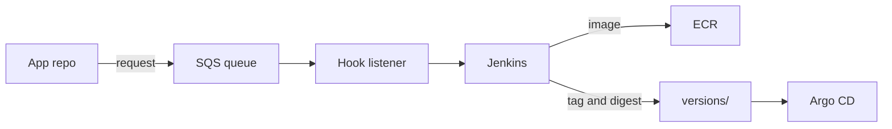
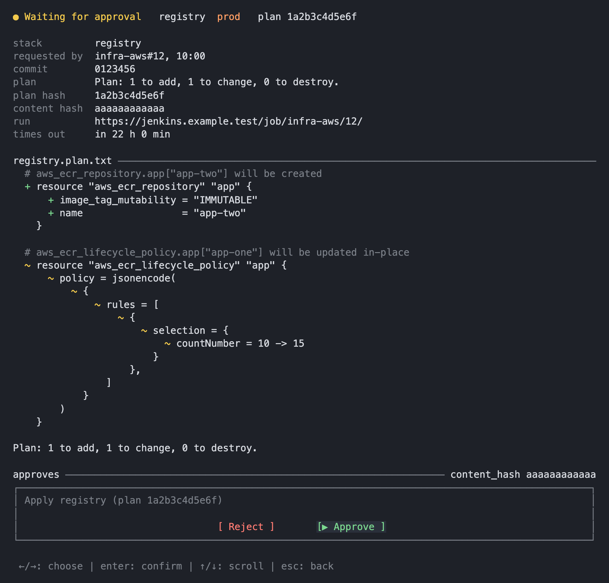

<h1 align="center">gitops-template</h1>

<p align="center">
  A GitOps repo for a Kubernetes cluster. Argo CD deploys the manifests, and Jenkins tests, builds and releases the apps.
</p>

## Stack

Kubernetes · Argo CD · Jenkins · Terraform · AWS

## Apps

`example-api` is a backend with Postgres that runs in the cluster for production and dev. `example-web` is a frontend that runs in the cluster for dev and on Cloudflare Pages for production. Both are examples without app code.

Each app has one file in `environments/`, which defines the Jenkins jobs, image repositories and IAM roles of the app.

## Deployment

Argo CD deploys branch `dev` to the dev environment and branch `prod` to production. A push to an app repo starts this flow:



A workflow in the app repo sends the queue a request with the repo, ref and commit, using the role from the Terraform output `deploy_hook_app_role_arn`. The hook listener in the cluster reads the request and starts the Jenkins job of the app. The job pushes the image to ECR and commits its tag and digest to `versions/`, and Argo CD deploys that commit.

To release to production, edit the version file of the app on `prod`, for example `versions/example-api/version.yaml`. The release then waits for an approval. The `deploy-hook` stack has a DynamoDB table for approval requests and a table for decisions, and a Lambda function sends each approved request to the queue.

A separate terminal client lists the approval requests and records the decisions:



## Pipeline library

The Jenkins jobs call steps from a shared library in a separate repo, which `platform/jenkins/values.yaml` sets as `your-org/ci-library`. The library must have these steps:

- `dispatch` starts the job that a request names.
- `testCommit` runs the tests of a commit.
- `deployImage` builds, scans, pushes and signs an image, then commits its tag and digest. For a production release, the step first waits for the approval.
- `deployPages` builds the site and publishes it to Cloudflare Pages.
- `applyTerraform` applies the stacks in `infra/aws`.
- `checkCertificates`, `scanImages` and `refreshTrivyDb` run on a schedule.

The tools image of the Jenkins agents and the hook listener image also come from outside this repo. Replace their placeholder digests of all zeros in `platform/jenkins/values.yaml` and `platform/jenkins-hook/deployment.yaml`.

## Setup

Every value to replace, such as `your-org`, `example.com` and the AWS account `123456789012`, has a `# change this:` comment. The cluster must have Argo CD and the Sealed Secrets controller, and the Traefik and storage files in `platform/` need k3s. To set up the repo, run:

```sh
# create the prod branch if the repo has only dev
git switch -c prod && git push -u origin prod

# set BUCKET and REGION in the script, then create the state bucket
infra/aws/bootstrap.sh

# fetch the sealing certificate of the cluster
kubeseal --fetch-cert > /tmp/sealed-cert.pem

# create the key that signs the Jenkins tokens for AWS, then commit infra/aws/account/oidc/jwks.json
platform/jenkins/manifests/create-oidc-signing-key.sh

# apply the three stacks, account first
for stack in account registry deploy-hook; do
  terraform -chdir=infra/aws/$stack init
  terraform -chdir=infra/aws/$stack apply
done

# set the values that each secret.example.yaml lists, then seal them
modules/example-api/components/production/seal-secrets.sh
platform/jenkins/manifests/seal-secrets.sh <values folder>
platform/jenkins-hook/seal-secrets.sh <certificate> <private key> <token file>
platform/cloudflared/seal-secrets.sh <credentials file>

# store the dev settings of example-api in Parameter Store
uv run --with boto3 --with pyyaml python3 scripts/seed_config.py example-api dev --from-env <file>

# start Argo CD on the repo
kubectl apply -f bootstrap/root-app.yaml
```

In GitHub, set the repository variables `AWS_DEPLOY_ROLE_ARN` and `AWS_VERIFY_ROLE_ARN` from the Terraform outputs `deploy_hook_gitops_role_arn` and `verify_role_arn`.

## License

MIT. See [LICENSE](LICENSE).
